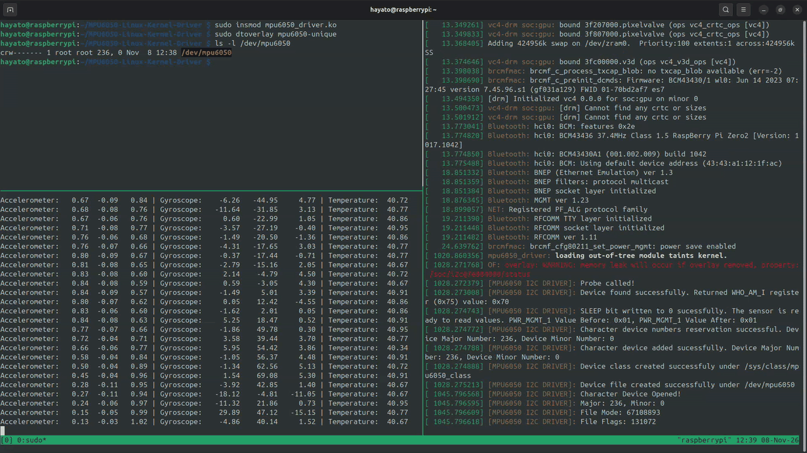
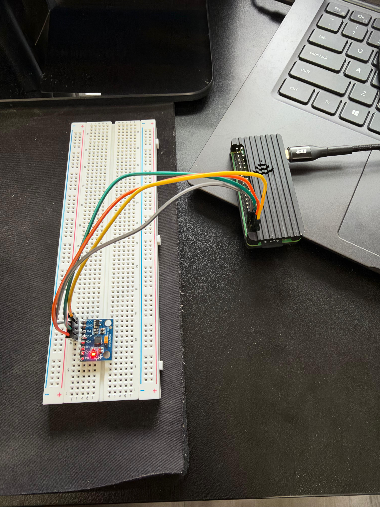

# MPU-6050 Linux Kernel I2C Device Driver

A Linux Kernel driver that exposes an MPU-6050 IMU as `/dev/mpu6050` character device file, plus a small userspace reader.

## DEMO



Top Left: leading the kernel driver module and device tree overlay. Bottom Left: userspace reader program reading sensor values device driver. Right: kernel log (`dmesg -w`).

## Overview

This is a implementation of I2C device driver for MPU-6050 written to learn the Linux device driver model (I2C client driver, probe/remove, device tree overlays, and character devices).

Board: Raspberry Pi Zero 2W
OS: Raspberry Pi OS Lite (64-bit), Debian 13
Sensor: MPU-6050

### What it does

- Binds the driver through a device tree overlay (and a `i2c_device_id` table provided for manual binding as well)
- Verifies the chip by reading the WHO_AM_I register at the beginning before starting communication with the chip
- Wakes up the chip with by clearing the SLEEP (bit 6) on the `PWR_MGMT_1` to 0.
- Creates a `/dev/mpu6050` to expose the device as character device file to userspace with open, release, and read implemented.
- The read returns 14 raw sensor bytes in one read operation, conversion to actual units is done in the userspace reader.

### Architecture

```
Reader application (userspace) --> /dev/mpu6050 --> mpu6050 driver (kernel) --> Linux I2c and SMBus Subsystem --> Pi I2C hardware controller --> MPU-6050 sensor
```

## Hardware and Wiring



| MPU-6050 pin | Pi Zero 2W pin | Function |
| --- | --- | --- |
| VCC | Pin 1 | 3.3V power |
| GND | Pin 6 | Ground |
| SDA | Pin 3 (GPIO 2) | I2C data |
| SCL | Pin 5 (GPIO 3) | I2C clock |

## Install and Build

### 1. Setup required

- Raspberry Pi OS Lite (64-bit) running on a Pi Zero 2W with SSH
- Sensor wired as shown above

### 2. Installing packages

```
sudo apt update && sudo apt upgrade -y
sudo apt install -y build-essential i2c-tools linux-headers-rpi-v8 device-tree-compiler
```

### 3. Enable I2C and verify sensor connectivity

```
sudo raspi-config
```
Go to Interface Options > I2C > Enable

```
sudo reboot
```

After reboot:
```
ls /dev/i2c*
sudo i2cdetect -y 1
```
You should see `68` (i2c address of the sensor) in the grid on i2c detect, if not check the wiring because the device is not detected.

### 4. Cloning the project and building the module

```
git clone https://github.com/AnujMongia1/MPU6050-Linux-Kernel-Driver.git
cd MPU6050-Linux-Kernel-Driver
make
```

This produces `mpu6050_driver.ko`.

### 5. Build and install device tree overlay

```
dtc -@ -I dts -O dtb -o mpu6050-unique.dtbo mpu6050-unique-overlay.dts
sudo cp mpu6050-unique.dtbo /boot/firmware/overlays/
```

The compatible string in device overlay `invensense,mpu6050-unique` must match the driver's `of_device_id` table exactly. If they are different the driver doesn't bind.

### 6. Loading the driver and overlay

Open a second terminal and run `sudo dmesg -w` to watch the kernel log, and then in the terminal run:

```
sudo insmod mpu6050_driver.ko
sudo dtoverlay mpu6050-unique
```

Loading the kernel module with `insmod` registers the driver, and the loading the overlay creates the I2C device at address `0x68` which triggers the probe and the character device registration process.

```
ls /dev/mpu6050
sudo i2cdetect -y 1
```

Verify the following:
- `dmesg` log shows the probe messages, including the WHO_AM_I value, and waking up the chip logs.
- /dev/mpu5060 exists
- `i2cdetect` shows `UU` at address 68 which means the kernel driver is using the sensor.

### 8. Using userspace reader

```
gcc userspace_reader.c -o userspace_reader
sudo ./userspace_reader
```

This will start printing out Accelerometer, Gyroscope, and Temperature sensor readings being read live from the sensor using the driver. The program can be stopper using Ctrl+C.


### 9. Process to unload the driver

```
sudo dtoverlay -r mpu6050-unique
sudo rmmod mpu6050_driver
```

`remove` function runs and puts the chip back to sleep by setting the SLEEP bit in PWR_MGMT_1 register, and destroys the device file (`/dev/mpu6050`).

## References and Resources Used

**Datasheets**

- [MPU-6000 and MPU-6050 Product Specification Revision 3.1](https://cdn.sparkfun.com/datasheets/Components/General%20IC/PS-MPU-6000A.pdf)
- [MPU-6000 and MPU-6050 Register Map and Descriptions Revision 4.0](https://cdn.sparkfun.com/datasheets/Sensors/Accelerometers/RM-MPU-6000A.pdf)

**Linux Kernel**

- Bootlin Elixir cross-referencer (used for looking up kernel functions and struct definitions): https://elixir.bootlin.com/linux/v6.18/source
- Linux kernel documentation, Implementing I2C device drivers: https://docs.kernel.org/i2c/writing-clients.html
- Linux Device Drivers, Third Edition by Jonathan Corbet, Alessandro Rubini, and Greg Kroah-Hartman.
